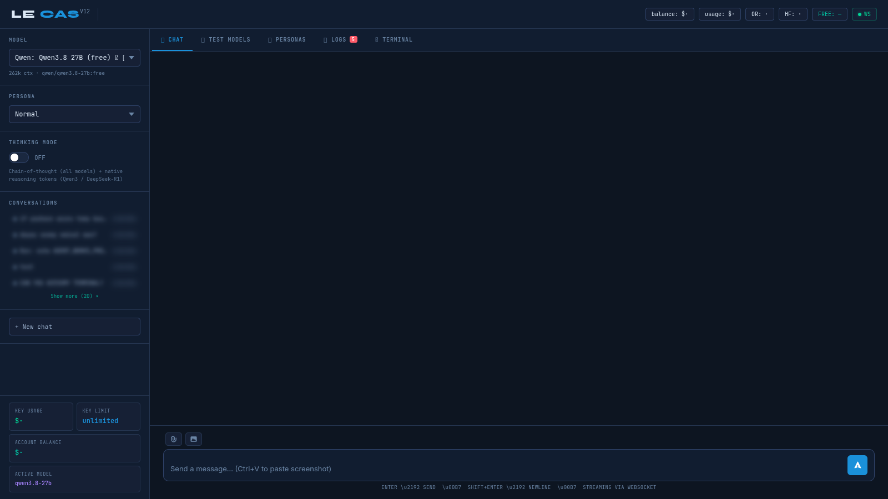

# LE CS Agent — Coding Station

Working with several AI providers can scatter conversations, model choices and coding work across different interfaces. LE CS Agent brings them into one coding station, combining a multi-provider conversation workspace, saved sessions and terminal access for a more continuous workflow.

## Tech stack

| Layer | Technologies |
|---|---|
| Application | JavaScript, Node.js, Fastify |
| Supporting technologies | HTML, CSS; DuckDB; xterm.js |

## Choose a model for the task

Select from the configured providers and supported models without rebuilding the conversation in a different application. Streaming responses keep progress visible, while available reasoning and search options support tasks that need a different approach. Usage information helps keep the current provider context in view.

A task may call for a different model without calling for a different workspace. The station keeps model selection and conversation tools close so the operator can choose deliberately.

## Bring files and images into the discussion

Attach relevant text or a screenshot when the model needs context beyond a written question. Supported vision models can work with images, while reusable personas help establish the type of assistance wanted. Custom personas let the workspace adapt to recurring tasks.

Files and images reduce the gap between describing a problem and showing the relevant material. Personas provide a reusable starting point when the same kind of assistance is needed again.

## Keep conversations useful

Saved sessions make it easier to return to an investigation or switch between pieces of work. Export a conversation when the result should be retained outside the station, and use code export tools where appropriate. This reduces repeated explanation when a task spans several sessions.

Saved conversations preserve the context of an investigation. Returning to a session is particularly useful when comparing approaches or continuing work after an interruption.

## Work beside a terminal

An embedded terminal keeps command-line work close to the discussion. The available agent mode connects model-assisted work with terminal output, while explicit session controls let the operator manage that workspace. This is an operational capability whose use should remain deliberate.

Discussion and command-line work can inform each other in the same session. The terminal remains visible as a working surface rather than an unexplained action happening elsewhere.

## Compare and troubleshoot

The model lab supports trying configured models on comparable tasks, helping choose a suitable option from experience rather than name alone. Logs and connection information assist with provider problems. Together, these areas make model experimentation part of the working station rather than a separate exercise.

Model comparisons are most useful when the task is comparable. The lab provides a place to examine the available choices, while diagnostics help separate a provider problem from the content of a response.

---

Private code: [le-cs-agent](https://github.com/logicencoder/le-cs-agent)

See [REPOS.md](REPOS.md) for related repositories.

**[Logic Encoder](https://logicencoder.com)** · [GitHub](https://github.com/logicencoder) · [Contact](https://logicencoder.com/contact/)
