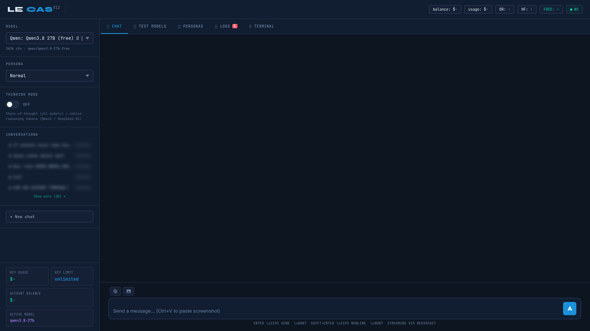

# LE CS Agent — Coding Station

Working with several AI providers can scatter conversations, model choices and coding work across different interfaces. LE CS Agent brings them into one coding station, combining a multi-provider conversation workspace, saved sessions and terminal access for a more continuous workflow.

## Tech stack

| Layer | Technologies |
|---|---|
| Application | JavaScript, Node.js, Fastify |
| Supporting technologies | HTML, CSS; DuckDB; xterm.js |

## Choose a model for the task

One interface talks to nine providers (OpenRouter, the Hugging Face router, Groq, Cerebras, Mistral, GitHub Models, NVIDIA, Google and Pollinations), lists the free ones, and shows provider credit and usage. With the model set to automatic, a failing model is skipped and the next one in the fallback list is tried; replies stream in as they are generated, and a **Thinking Mode** switch asks for chain-of-thought on any model and uses native reasoning tokens on models that provide them (such as Qwen3 and DeepSeek-R1).

A task may call for a different model without calling for a different workspace. The station keeps model selection and conversation tools close so the operator can choose deliberately.

## Bring files and images into the discussion

Attach relevant text or a screenshot when the model needs context beyond a written question. Supported vision models can work with images, while reusable personas help establish the type of assistance wanted. Custom personas let the workspace adapt to recurring tasks.

Files and images reduce the gap between describing a problem and showing the relevant material. Personas provide a reusable starting point when the same kind of assistance is needed again.

## Keep conversations useful

Every conversation is saved to a local DuckDB database as a session that can be reopened or cleared, and **Export MD** writes a chat out as Markdown.

Saved conversations preserve the context of an investigation. Returning to a session is particularly useful when comparing approaches or continuing work after an interruption.

## Work beside a terminal

An embedded terminal (xterm.js over a pseudo-terminal, with a choice of WSL distribution) keeps command-line work next to the discussion. In agent mode the model can reply with a shell block that the server runs in that terminal, so the operator should enable it deliberately and only on a machine where that is acceptable.

Discussion and command-line work can inform each other in the same session. The terminal remains visible as a working surface rather than an unexplained action happening elsewhere.

## Compare and troubleshoot

The model lab checks each configured model with a one-word test prompt and stores the outcome per model: whether it answered and how fast. A separate benchmark does the same for the free Hugging Face models. It is a reachability and speed check, not a comparison of answer quality, but the stored scores show which models are worth using and which are down. A status view reports the provider connections and errors.

Model comparisons are most useful when the task is comparable. The lab provides a place to examine the available choices, while diagnostics help separate a provider problem from the content of a response.

---

Private code: [le-cs-agent](https://github.com/logicencoder/le-cs-agent)

See [REPOS.md](REPOS.md) for related repositories.

**[Logic Encoder](https://logicencoder.com)** · [GitHub](https://github.com/logicencoder) · [Contact](https://logicencoder.com/contact/)
